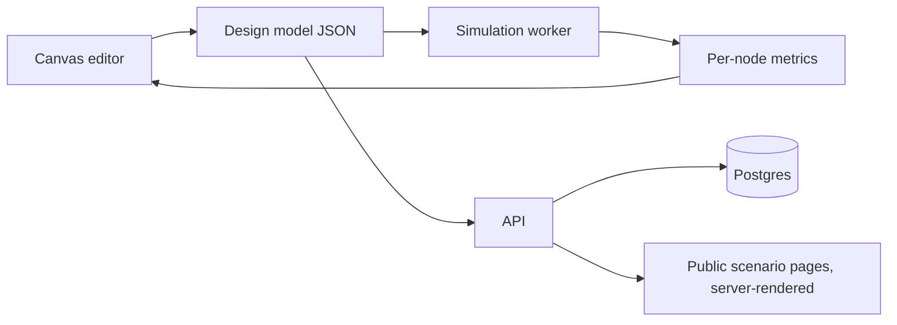

# Projects

A portfolio is read in about two minutes. What survives that read is a live URL, a clear sentence
about who it is for, and evidence that real people used it. These four ideas are picked so that
each one also forces you to practise something from [`system-design/`](../system-design/).

**An honest note on "nobody has built this".** I can't verify that from here, and neither can you
yet. Before writing code, spend one evening on a market scan: search the idea, list the five closest
tools, write down what each does badly. If you can't state a sharp difference in one sentence, change the idea,
not the marketing. Treat "revolutionary" as something users tell you, measured by whether they come back.

---

## 1. ArchPlay: a scale simulator for system designs

**Problem.** Design diagrams are static, so a bad design looks as convincing as a good one.
**What it is.** Drag a load balancer, app servers, cache, database and queue onto a canvas, set the
traffic, and watch where it saturates. Utilisation, queue length and latency per box, computed from
basic queueing theory (arrival rate, service rate, Little's law), with a "break it" button that kills a node
or spikes the traffic 10x.

**Why it's different.** Most diagram tools draw; most load tools need a running system. This one sits between: a design
you can stress before building anything.

| | |
|---|---|
| Stack | TypeScript, React, canvas/SVG editor, simulation in a Web Worker, Postgres for saved designs |
| 2-week MVP | 6 component types, one traffic slider, bottleneck highlight, shareable link |
| Skills it builds | Queueing basics, discrete-event simulation, frontend performance, URL-addressable state |
| Revenue | Free tier + ads on public scenario pages; paid tier for private designs and team sharing |
| SEO angle | Every shared scenario is a public page: "URL shortener at 10k RPS", "Chat at 1M connections" |

## 2. Outage Atlas: real incidents as playable puzzles

**Problem.** Postmortems are great teachers and nobody reads them to the end.
**What it is.** Take a public incident, write it up in your own words with credit and a link to the
original, and turn it into an interactive question: here is the architecture, here is the symptom, what do you check first? Reveal the
real cause step by step. Tag by failure type (cascading retries, bad config push, clock skew, hot partition).

| | |
|---|---|
| Stack | Static site generator (Astro or Next.js), MDX content, small quiz component |
| 2-week MVP | 10 incidents, tags, reading-time and difficulty |
| Skills it builds | Reading real failure data, technical writing, SEO |
| Revenue | Content site, so display ads fit naturally; newsletter sponsorship later |
| Rule | Never copy a postmortem's text or diagrams. Summarise, credit, link |

Pairs well with ArchPlay: each incident can open a pre-built scenario in the simulator.

## 3. Replay: practice recall, not just solutions

**Problem.** You solve a problem, feel good, and forget it in a month.
**What it is.** An editor extension or web app that records *how* you solved something (timeline of edits and
your own notes), then schedules spaced prompts: "Here is the problem. What was the key insight?" before showing your own earlier path.
This repo's tracker is the prototype; Replay is the product version.

| | |
|---|---|
| Stack | VS Code extension (TypeScript), local-first storage, optional sync API |
| 2-week MVP | Record one session, replay it, schedule 3-7-21 day reminders |
| Skills it builds | Event logging, sync and conflict handling, extension APIs |
| Revenue | Free local use; paid sync and team dashboards. Ads do not fit a dev tool |

## 4. RPM Lens: ad revenue analytics for small publishers

**Problem.** Small site owners see total earnings, but not which pages earn, why one page pays 5x another,
or what to write next.
**What it is.** Connects to your ad network's reporting and Google Search Console, then shows
revenue per thousand pageviews by page, topic and traffic source, plus "pages with traffic but low RPM".
You run it on your own sites first, which gives you real data and a real case study.

| | |
|---|---|
| Stack | Python or Node ingest jobs, Postgres, charting frontend, OAuth to the data sources |
| 2-week MVP | Import two reports, one table: page, views, revenue, RPM |
| Skills it builds | OAuth, scheduled ingestion, idempotent pipelines, data modelling |
| Revenue | Subscription. A small, paying niche beats a large free audience |

---

## Recommended path

Build **ArchPlay and Outage Atlas as one site**. They feed each other, they rank in search because
system design is a heavily searched topic, and the content doubles as your interview preparation.
Add RPM Lens later, running on that site, so its numbers are real.

| Weeks | Goal |
|---|---|
| 1 to 2 | ArchPlay MVP deployed on a real domain, 5 scenarios |
| 3 to 4 | Outage Atlas with 10 incidents, analytics installed, sitemap submitted |
| 5 to 8 | Share where learners already are (relevant subreddits, dev forums, Hacker News "Show HN"), fix what people trip on |
| 9 to 12 | Add ads or a paid tier based on what the numbers say |

## Ads and measuring popularity

**Measuring**
- Privacy-friendly analytics (Plausible, Umami, or self-hosted PostHog) or Google Analytics 4. Track visitors, returning visitors, top pages, referrers.
- Google Search Console for impressions, clicks and the queries that find you.
- The numbers that matter: weekly returning visitors, scenario shares, and how many people finish a puzzle. Total pageviews alone flatter you.

**Ads, realistically**
- Display ads (such as Google AdSense) need original content, a privacy policy, clear navigation and enough pages to pass review. Plan for that before applying.
- Never click your own ads or ask others to. It violates the programme policies and gets accounts banned.
- Visitors in the EU and UK need a consent banner before ad cookies load.
- Expect small money at first. Earnings scale with traffic and niche; think thousands of monthly visitors before it covers a domain name, and far more before it matters. Developer audiences also block ads often.
- The stronger revenue paths for this kind of site are a paid tier, a newsletter with one sponsor, and the job offers the portfolio itself produces.

## Definition of done for each project

A live URL, a README with a screenshot and architecture diagram, a short write-up of one hard decision and what you'd change, and at least 20 real users who are not your friends.
