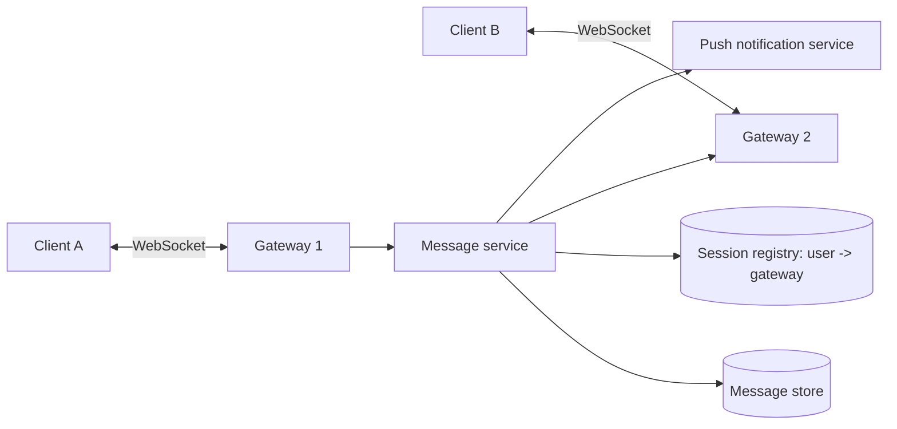

# Chat System

> One-to-one and group messaging with delivery receipts and history.

## 1. Requirements

**Functional**
- Send and receive messages in real time (1:1 and groups up to a few hundred).
- Online / offline presence, delivered and read receipts.
- Message history, available on multiple devices.

**Out of scope:** voice and video, end-to-end encryption details, media transcoding.

**Non-functional**
- Delivery in well under a second when both users are online.
- Never lose an accepted message. Per-conversation ordering must be correct.

## 2. Estimates

| Quantity | Working | Result |
|---|---|---|
| Concurrent connections | 20M | memory per connection matters; ~10 to 100 KB each means big gateway fleets |
| Messages | 50M users x 40 a day | ~23k per second average |
| Storage | 2B messages a day x ~100 bytes | ~200 GB a day before replication |

## 3. High-level design

1. A sends over its WebSocket to its gateway.
2. The message service assigns an id and writes to the store **before** acknowledging.
3. It looks up which gateway B is connected to and forwards. If B is offline, it sends a push notification and B syncs on reconnect.

## 4. Deep dive

**Ordering.** Global ordering is unnecessary and expensive. You need order *within a conversation*.
Give each conversation its own monotonically increasing sequence number (assigned by the service that
owns that conversation's partition). Clients render by sequence and detect gaps.

**Delivery guarantee.** The pipeline is at-least-once: the sender retries until it gets an ack, so the
receiver can see duplicates. The message id lets clients drop repeats, which makes delivery effectively once.

**Storage.** Access is "latest N messages in conversation X", write-heavy and append-only. A wide-column
or partitioned key-value store keyed by (conversationId, sequence) fits. A relational store works until the
volume forces sharding by conversation.

**Groups.** Fan-out per recipient is fine for hundreds of members. For huge channels, clients pull
rather than the server pushing to every member.

**Presence.** Heartbeats every few seconds refresh a TTL key. Don't broadcast every presence change to
every contact; send it to users who currently have that chat open or visible.

## 5. Failure modes and trade-offs

| What breaks | What the user sees | What we do |
|---|---|---|
| Gateway crashes | Clients reconnect | Reconnect to another gateway, request messages after the last sequence they saw |
| Message service retries | Possible duplicates | Idempotent by message id |
| Recipient offline for days | Missing live delivery | Push notification now, full sync from store later |
| Slow consumer | Backlog on the server | Bound buffers and drop to pull-based sync |

## 6. In production

- Discord has written publicly about storing messages partitioned by channel and time bucket, and about moving its message store between databases as volume grew. The access pattern, not the brand of database, is what drives the design.
- WhatsApp is widely cited for serving enormous connection counts per server using Erlang, which is a reminder that connection handling is the first scaling wall.
- Mobile realities dominate: flaky networks, background restrictions, and battery. The sync-from-last-sequence protocol is what makes the app feel reliable.
