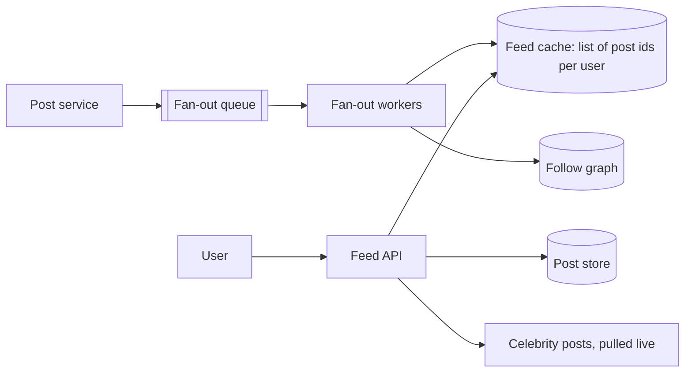

# News Feed

> Show each user a ranked stream of posts from the people they follow.

## 1. Requirements

**Functional**
- Publish a post (text, image reference).
- Follow and unfollow users.
- Fetch my feed: recent posts from people I follow, newest or ranked, with pagination.

**Out of scope:** ranking model internals, ads, comments.

**Non-functional**
- Feed loads in under ~300 ms. Posts may take a few seconds to appear for followers (eventual consistency is fine).
- Highly read-heavy.

## 2. Estimates

| Quantity | Working | Result |
|---|---|---|
| Users | 100M DAU, 10 feed loads/day | ~12k feed reads per second |
| Posts | 20M a day | ~230 per second |
| Average followers | 200 | one post means ~200 feed updates |
| Skew | a few accounts have tens of millions of followers | the hard case |

## 3. The central decision: fan-out

| Strategy | On post | On feed read | Good when |
|---|---|---|---|
| **Fan-out on write** (push) | Copy the post id into every follower's feed list | Read one precomputed list | Reads are the hot path, followers are few |
| **Fan-out on read** (pull) | Store the post once | Gather recent posts from everyone I follow and merge | Authors have enormous follower counts |
| **Hybrid** | Push for normal users | Pull for celebrities and merge at read time | Real systems |

A post by someone with 30M followers would trigger 30M writes. So accounts above a follower threshold
are not pushed. Their recent posts are fetched at read time and merged into the precomputed feed.

## 4. High-level design

## 5. Data model

| Entity | Key | Notes |
|---|---|---|
| Post | postId (time-ordered ID) | Stored once. Time-ordered IDs make "newest first" a key scan |
| Follow edge | (followerId, followeeId), indexed both ways | Needs "who do I follow" and "who follows me" |
| Feed | userId -> list of postIds | Capped, say the latest 800. Older pages fall back to the pull path |

The feed holds ids only. The API loads post bodies in a batch, so editing or deleting a post
doesn't require rewriting millions of feed entries.

## 6. Failure modes and trade-offs

| What breaks | What the user sees | What we do |
|---|---|---|
| Fan-out queue lags | New posts appear late | Acceptable, alert on queue age |
| Feed cache lost | Empty or slow feed | Rebuild on demand from the pull path |
| Unfollow or delete | Stale entries | Filter on read; cleanup lazily |
| Celebrity posts go viral | Read spike on one author | Cache that author's recent posts aggressively |

## 7. In production

- Twitter has publicly described a hybrid like this: precomputed timelines for most users, with very-high-follower accounts merged in at read time.
- Ranked feeds add a scoring step after candidate retrieval. Retrieval and ranking are usually separate services so each can scale and ship independently.
- Pagination uses a cursor (last seen id), not page numbers, because the feed keeps changing while you scroll.
