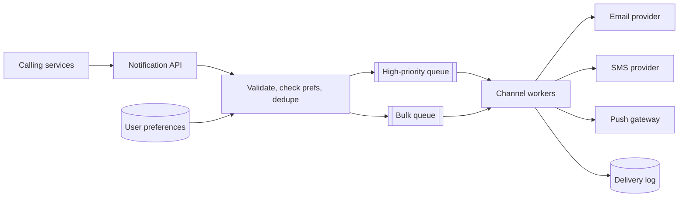

# Notification System

> Send email, SMS and push messages reliably, respecting what each user wants.

## 1. Requirements

**Functional**
- Services call one API to notify a user; the system picks the channel(s).
- Templates, localisation, scheduled and bulk sends.
- User preferences and opt-outs per channel and per category.

**Non-functional**
- Transactional messages (password reset, OTP) arrive within seconds. Marketing can wait.
- No duplicates and no lost messages. Providers (email, SMS, push gateways) will fail and rate-limit you.

## 2. Estimates

100M users, 5 notifications a day each is ~500M a day, ~6k per second on average with big peaks when a
campaign launches. Provider throughput limits, not your servers, are usually the bottleneck.

## 3. High-level design

## 4. Deep dive

**Separate queues by priority and by channel.** An OTP must not wait behind a million newsletter emails.
Each channel has its own workers so a slow SMS provider doesn't stall push.

**Idempotency.** The caller sends an idempotency key (for example `orderId + template`). The API stores
seen keys for a window and returns the earlier result instead of sending twice. Queues deliver at-least-once,
so workers also check the delivery log before sending.

**Retries.** Retry transient failures with exponential backoff and jitter. After N attempts move the job to
a dead-letter queue and alert. Fall back to a secondary provider if the primary is down.

**Rate limiting outbound.** Providers cap your sending rate and punish spikes. Workers use a token bucket
per provider. See [rate-limiter](rate-limiter.md).

**Preferences and compliance.** Check opt-out at send time, not enqueue time, because a user may unsubscribe
while a message waits. Keep an audit trail; legal rules around marketing messages are strict.

## 5. Failure modes and trade-offs

| What breaks | What the user sees | What we do |
|---|---|---|
| Provider outage | Delay | Failover provider, keep jobs in queue |
| Worker crashes mid-send | Possible double send | Delivery log check plus provider-side idempotency where supported |
| Campaign floods the queue | Slow bulk, normal transactional | Separate queues and capacity |
| Invalid device tokens | Failed pushes | Delete tokens that the gateway reports as invalid |

## 6. In production

- Delivery is never certain: push can be dropped by the OS, email lands in spam. Track delivered, opened and clicked as separate events, and treat them as signals rather than guarantees.
- Throttle and batch notifications per user ("5 new comments" instead of 5 pushes). Over-notification is the fastest way to get uninstalled.
- Keep the template and preference data close to the sender so a send needs no call to a dozen other services.
