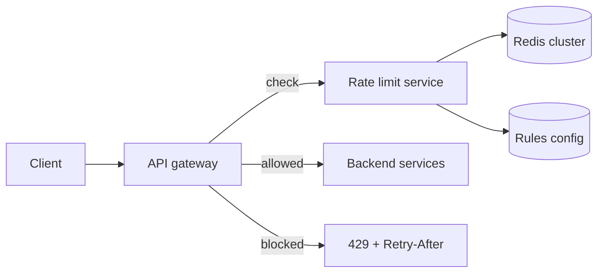

# Rate Limiter

> Stop one client from using more than its share, without slowing down everyone else.

## 1. Requirements

**Functional**
- Limit requests per client (API key, user id, or IP) by rule, such as 100 per minute.
- Return `429 Too Many Requests` with a `Retry-After` header when over the limit.
- Rules can differ by endpoint and plan.

**Non-functional**
- Adds under ~1 ms to each request.
- Works across many app servers, so the count must be shared.
- If the limiter itself fails, the product should keep working (fail open) unless it is protecting something dangerous.

## 2. Estimates

100k requests per second across the fleet, 10M distinct clients, each tracked with a small counter
(~50 bytes). That is ~500 MB of state. It fits in memory on a small cache cluster.

## 3. Algorithms

| Algorithm | How | Good at | Weak at |
|---|---|---|---|
| Fixed window | Counter per minute bucket | Simplest, cheapest | A burst at the boundary can pass 2x the limit |
| Sliding window log | Store a timestamp per request | Exact | Memory per client grows with the limit |
| Sliding window counter | Weight the previous window and the current one | Cheap and close to exact | Approximate |
| **Token bucket** | Bucket refills at a steady rate, a request spends a token | Allows controlled bursts, tiny state | Needs two numbers per client |
| Leaky bucket | Requests drain at a fixed rate | Smooths traffic | Bursts queue or drop |

Token bucket is the usual default: two numbers per client (tokens, last refill time) and it matches
how people think about "100 per minute, but a burst of 20 is fine".
Runnable version: [`implementations/TokenBucketRateLimiter.java`](../implementations/TokenBucketRateLimiter.java).

## 4. High-level design

Where to run it: in the gateway or as middleware, so rejected traffic never reaches the backend.

## 5. Deep dive: shared counters without races

Two servers reading a count, adding one, and writing it back will lose updates. Do the
read-modify-write **atomically inside the store**: a Redis Lua script (or `INCR` plus `EXPIRE` for a
fixed window) runs as one step. The script takes the current time from the store, not from the app
server, so clock skew between servers cannot cheat the refill.

Reduce load on the shared store by letting each server take a small local allowance (a batch of tokens)
and sync periodically. You trade a little accuracy for far fewer network calls.

## 6. Failure modes and trade-offs

| What breaks | What the user sees | What we do |
|---|---|---|
| Store unreachable | Nothing, if failing open | Fall back to a per-server in-memory limit |
| Hot client | Gets 429s | Correct behaviour; log it, offer a higher plan |
| Many clients behind one IP | Unfair blocking | Prefer API key or user id over IP where possible |
| Retry storms after a 429 | Load spikes | Send `Retry-After`, tell clients to use backoff with jitter |

## 7. In production

- Public APIs commonly return the remaining quota in response headers so well-behaved clients can pace themselves.
- Limits usually come in layers: per second to stop bursts, per day for billing, and a global circuit to protect the database.
- Separate "rate limiting" (fairness) from "load shedding" (survival under overload). They solve different problems.
