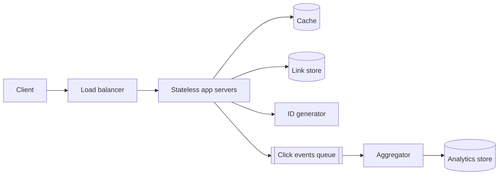

# URL Shortener

> Turn a long link into a short one, and redirect fast when someone opens it.

## 1. Requirements

**Functional**
- Create a short link from a long URL, optionally with a custom alias and an expiry.
- Redirect a short link to the original URL.
- Count clicks per link.

**Out of scope:** user accounts, link editing, abuse review UI.

**Non-functional**
- Redirect latency in the tens of milliseconds. Reads dominate, so favour availability over strict consistency on reads.
- Links must never collide, and a created link must never silently change target.

## 2. Estimates

| Quantity | Working | Result |
|---|---|---|
| New links | assume 100M per month | ~40 per second |
| Redirects | read:write 100:1 | ~4,000 per second, peak maybe 20k |
| Storage | 100M x 12 months x 5 years x ~500 bytes | ~3 TB |
| Key space | 7 characters of Base62 | 62^7 ~ 3.5 trillion, plenty |

## 3. API

```
POST /api/links        { url, alias?, expiresAt? } -> { shortUrl }
GET  /{code}           -> 301 or 302 to the long URL
GET  /api/links/{code}/stats -> { clicks, byDay[] }
```

Use **302** if you want every click to reach your servers (analytics, expiry, edits). Use 301 only if
you accept that browsers will cache the redirect and you lose visibility.

## 4. Data model

| Entity | Key | Fields | Store and why |
|---|---|---|---|
| Link | code | longUrl, createdAt, expiresAt, ownerId | Key-value or sharded SQL. Lookups are always by code |
| Click event | (code, time) | country, device, referrer | Append-only log, aggregated offline or by stream |

## 5. High-level design



## 6. Deep dive: generating the code

| Option | Idea | Problem |
|---|---|---|
| Hash the URL, take 7 chars | Deterministic, same URL gives same code | Collisions must be detected and retried |
| Random 7 chars | Simple | Collision checks on every write |
| **Counter encoded in Base62** | Unique by construction | Counter becomes a bottleneck, and codes are guessable |

A good compromise: each app server leases a **block of IDs** (say 10,000 at a time) from a small
coordinator, then hands them out locally with no network call. Encode in Base62. To stop people
walking the sequence, run the number through a reversible shuffle (a bijective mix) before encoding.
See [`implementations/Base62.java`](../implementations/Base62.java).

Read path: check cache, on miss read the store, fill the cache with a TTL. Since popular links follow
a heavy-tailed distribution, a modest cache catches most traffic.

## 7. Failure modes and trade-offs

| What breaks | What the user sees | What we do |
|---|---|---|
| Cache down | Slower redirects | Fall back to the store, rate-limit to protect it |
| ID coordinator down | New links fail | Servers keep their remaining block, the reads are unaffected |
| Hot link goes viral | One cache key takes huge load | Short in-process cache in front of the shared cache |
| Click queue backs up | Stats lag | Redirects never wait on analytics, events are fire-and-forget |

## 8. In production

- Real shorteners separate the redirect path (tiny, cacheable, globally replicated) from the management path (accounts, dashboards).
- Many put redirects at the CDN or edge layer so the origin barely sees traffic.
- Abuse is the real operational cost: phishing links, malware, redirect loops. Expect a blocklist check and scanning on create.
